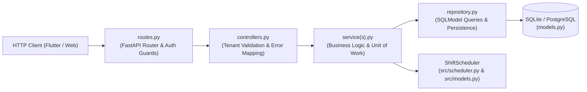

# Backend Architecture

## 1. Overview

The **Schedule-Maker Backend** (`Hospital Shift Scheduler API`) is a Python service that manages multi-tenant hospital department rosters and generates optimized monthly on-duty schedules for doctors.

At its core, the backend combines:
1. **A RESTful API Layer (FastAPI)** for authentication, invitation-based onboarding, department/team/position/shift/doctor management, and schedule lifecycle workflows.
2. **A Constraint Programming Solver Engine (Google OR-Tools CP-SAT)** that computes fair, balanced shift assignments while enforcing hard operational rules (e.g., shift staffing levels, doctor unavailabilities, pre-assignments, no consecutive duties, position eligibility) and optimizing soft quality-of-life objectives (e.g., weekend fairness, full weekends off, spacing between shifts).
3. **A Hybrid Persistence Layer (SQLModel / SQLAlchemy)** supporting both local standalone execution via **SQLite** and central multi-user deployments via **PostgreSQL**, equipped with synchronization metadata (`SyncBase`).

---

## 2. Technology Stack

| Layer / Concern | Technology | Purpose |
| :--- | :--- | :--- |
| **Web Framework** | FastAPI + Uvicorn | Asynchronous HTTP API, dependency injection, and OpenAPI schema generation |
| **ORM & Validation** | SQLModel + Pydantic v2 | Relational database mapping and strict request/response schema validation |
| **Database** | SQLite / PostgreSQL | Local single-file DB (`hospital_schedule.db`) for dev/desktop; PostgreSQL via `DATABASE_URL` in production |
| **Optimization Engine** | Google OR-Tools (`cp_model`) | CP-SAT constraint satisfaction and objective optimization (`ShiftScheduler`) |
| **Spreadsheet I/O** | OpenPyXL + Pandas | Parsing uploaded `.xlsx` rosters and exporting styled monthly schedule workbooks |
| **Holiday Calendar** | `holidays` | Country-aware public holiday detection (defaulting to `GR`) for weekend/holiday duty balancing |
| **Authentication** | PyJWT + `bcrypt` | Short-lived JWT access tokens, rotating refresh sessions, and password hashing |
| **Primary Keys** | `uuid6` (`uuid7`) | Time-ordered UUIDv7 primary keys across all database entities |

---

## 3. Folder Structure

The backend uses a **Feature-Based Layered Architecture**. Instead of grouping all routes, models, or controllers into global top-level folders, each domain feature under `src/` encapsulates its own HTTP endpoints, controller adapters, business services, persistence repositories, ORM models, Pydantic schemas, and tests.

```text
backend/
├── data/                               # Local data files and sample templates
├── docs/                               # Architecture, authentication, and workflow documentation
│   ├── architecture.md                 # This document
│   ├── structure.md                    # Feature-based layout conventions
│   └── ...
├── scripts/                            # Administrative CLI utilities & smoke tests
│   ├── bootstrap_super_admin.py        # CLI tool to provision the initial Super Admin
│   ├── bootstrap_department_admin.py   # CLI tool to provision a Department & Department Admin
│   └── smoke_test_authentication.ps1   # End-to-end authentication smoke test script
├── src/                                # Main application source package
│   ├── main.py                         # FastAPI app initialization, middleware, exception handlers, router mounting
│   ├── models.py                       # Pure Python dataclasses (Department, Team, Position, Shift, Doctor, ScheduleConfig) for the solver
│   ├── scheduler.py                    # Google OR-Tools CP-SAT scheduling engine (ShiftScheduler)
│   ├── schedule_maker.py               # Standalone CLI/script prototype for Excel-to-Excel schedule solving
│   │
│   ├── db/                             # Database infrastructure & shared base schemas
│   │   ├── connection.py               # SQLAlchemy/SQLModel engine, SQLite FK pragma, init_db(), get_session()
│   │   └── schemas.py                  # SyncBase abstract base model and ScheduleConfig DB table
│   │
│   ├── auth/                           # Authentication, sessions, RBAC dependencies & invitations
│   │   ├── routes.py                   # /api/v1/auth endpoints (login, signup, refresh, logout, invitations)
│   │   ├── controllers.py              # HTTP request/cookie/CSRF handling and response mapping
│   │   ├── services.py                 # Auth business logic, token rotation, reuse detection, provisioning
│   │   ├── repository.py               # Persistence queries for Invitation and RefreshSession
│   │   ├── dependencies.py             # FastAPI security dependencies (get_current_user, require_role, require_department_scope)
│   │   ├── security.py                 # JWT encoding/decoding, bcrypt hashing, token/CSRF generation
│   │   ├── bootstrap.py                # Idempotent admin bootstrap logic
│   │   ├── models.py                   # Invitation and RefreshSession SQLModel tables
│   │   ├── schemas.py                  # Auth & invitation Pydantic request/response schemas
│   │   └── tests/                      # Auth unit, security matrix, and route protection tests
│   │
│   ├── user/                           # User account management
│   │   ├── routes.py                   # /api/v1/users endpoints
│   │   ├── controllers.py              # User controller handlers
│   │   ├── services.py                 # User account business services
│   │   ├── repository.py               # User DB queries
│   │   ├── models.py                   # User SQLModel table and UserRole enum
│   │   ├── schemas.py                  # UserRead and related Pydantic schemas
│   │   └── tests/                      # User feature tests
│   │
│   ├── department/                     # Hospital department management
│   │   ├── routes.py                   # /api/v1/departments endpoints
│   │   ├── controllers.py              # Department controllers
│   │   ├── repository.py               # Department DB queries
│   │   ├── models.py                   # Department SQLModel table
│   │   ├── schemas.py                  # DepartmentRead/Create schemas
│   │   └── tests/                      # Department feature tests
│   │
│   ├── team/                           # Doctor team groupings within a department
│   │   ├── routes.py                   # /api/v1/teams endpoints
│   │   ├── controllers.py              # Team controllers
│   │   ├── repository.py               # Team DB queries
│   │   ├── models.py                   # Team SQLModel table
│   │   ├── schemas.py                  # TeamCreate/Read schemas
│   │   └── tests/                      # Team feature tests
│   │
│   ├── position/                       # Staffing positions (e.g., ER, ICU, Ward)
│   │   ├── routes.py                   # /api/v1/positions endpoints
│   │   ├── controllers.py              # Position controllers
│   │   ├── repository.py               # Position DB queries
│   │   ├── models.py                   # Position SQLModel table (with JSON duty_days)
│   │   ├── schemas.py                  # PositionCreate/Read schemas
│   │   └── tests/                      # Position feature tests
│   │
│   ├── shift/                          # Shift definitions & published shift assignments
│   │   ├── routes.py                   # /api/v1/shifts endpoints (shifts & /assignments)
│   │   ├── controllers.py              # Shift controllers
│   │   ├── repository.py               # Shift and ShiftAssignment DB queries
│   │   ├── models.py                   # Shift and ShiftAssignment SQLModel tables
│   │   ├── schemas.py                  # ShiftCreate/Read and ShiftAssignmentCreate/Read schemas
│   │   └── tests/                      # Shift feature tests
│   │
│   ├── doctor/                         # Doctors, position eligibility, unavailabilities & pre-assignments
│   │   ├── routes.py                   # /api/v1/doctors endpoints (CRUD, /roster, /unavailability, /pre-assignments, /position)
│   │   ├── controllers.py              # Doctor controllers
│   │   ├── repository.py               # Doctor & constraint DB queries
│   │   ├── models.py                   # Doctor, DoctorUnavailability, DoctorPreAssignment, DoctorPosition tables
│   │   ├── schemas.py                  # Doctor, roster, unavailability, and pre-assignment schemas
│   │   └── tests/                      # Doctor feature tests
│   │
│   ├── schedule/                       # Schedule generation, drafts, Excel sync/export & publishing
│   │   ├── routes.py                   # /api/v1/schedules endpoints (generate, draft, export, publish, diff, target-month)
│   │   ├── controllers.py              # Tenant verification, input validation, and service orchestration
│   │   ├── service.py                  # Solver execution, Excel roster sync, Excel export, and atomic draft publishing
│   │   ├── repository.py               # ScheduleDraft persistence queries
│   │   ├── roster_assembler.py         # Hydrates the solver Department dataclass graph from relational DB tables
│   │   ├── excel_parser.py             # Parses uploaded .xlsx workbooks (Doctors & Shifts sheets) into solver dataclasses
│   │   ├── models.py                   # ScheduleDraft SQLModel table (with JSON assignments & unavailabilities)
│   │   ├── schemas.py                  # ScheduleDraftRead, ScheduleSummaryRead, ExcelRosterDiffResponse, etc.
│   │   └── tests/                      # Schedule solver, parser, assembler, and endpoint tests
│   │
│   ├── utils/                          # Cross-cutting infrastructure utilities
│   │   ├── logger.py                   # Structured JSON logging, request correlation IDs, and security audit logger
│   │   ├── rate_limiter.py             # Thread-safe in-memory sliding-window rate limiter
│   │   ├── email.py                    # Email notification helpers
│   │   ├── excel.py                    # Shared Excel formatting utilities
│   │   └── misc.py                     # Timing and general helper functions
│   │
│   ├── windows/                        # Desktop GUI wrapper
│   │   └── app.py                      # CustomTkinter desktop window entry point
│   │
│   └── tests/                          # Cross-feature and solver integration tests
│
├── conftest.py                         # Root pytest fixtures and test configuration
├── Dockerfile                          # Container image definition for the FastAPI backend
├── pyproject.toml                      # Project metadata, dependencies (uv), and pytest settings
└── uv.lock                             # Locked dependency graph
```

---

## 4. Layered Architecture Within Each Feature

Every feature package under `src/<feature>/` adheres to strict unidirectional layer boundaries:



1. **Routes (`routes.py`)**:
   - Declares HTTP paths, status codes, and `response_model` schemas (`schemas.py`).
   - Injects the database session (`Depends(get_session)`) and authentication/authorization guards (`Depends(require_department_admin)`, `Depends(require_department_scope)`, etc.).
   - Contains no business or persistence logic; delegates immediately to `controllers.py`.
2. **Controllers (`controllers.py`)**:
   - Validates HTTP-specific inputs (e.g., checking `.xlsx` file extensions) and enforces tenant boundaries (such as verifying whether a user can act on a requested `department_id`).
   - Calls into the service layer (or directly into the repository for simple CRUD operations) and translates domain exceptions (such as `ValueError`) into appropriate `fastapi.HTTPException` responses.
3. **Services (`service.py` / `services.py`)**:
   - Houses core domain logic, multi-repository orchestration, and external engine invocations (such as running `ShiftScheduler` or generating `.xlsx` bytes).
   - Acts as the **ACID Unit of Work**: multi-step mutations stage changes via `session.flush()` (or `commit=False` in repositories) and execute a single atomic `session.commit()` at the end of the business operation so any intermediate error triggers a clean rollback.
4. **Repositories (`repository.py`)**:
   - Encapsulates all SQLModel/SQLAlchemy `select`, `add`, and soft-delete queries.
   - Consistently filters out soft-deleted rows (`not_(Model.is_deleted)`) and scopes queries by `department_id`.
5. **Models & Schemas (`models.py` & `schemas.py`)**:
   - `models.py` defines feature-local SQLModel table classes (`table=True`) inheriting from `SyncBase`.
   - `schemas.py` defines Pydantic data transfer contracts (`*Create`, `*Read`, `*Response`) to decouple internal DB tables from public API payloads.

---

## 5. Dual Domain Model & Solver Pipeline

A key architectural distinction in the backend is the separation between **Relational Persistence Models** and **In-Memory Solver Domain Models**:

- **Persistence Models (`src/<feature>/models.py`)**: Normalized SQLModel tables (`Department`, `Team`, `Position`, `Shift`, `Doctor`, `DoctorPosition`, `DoctorUnavailability`, `DoctorPreAssignment`, `ShiftAssignment`, `ScheduleDraft`) stored in SQLite/PostgreSQL.
- **Solver Domain Models (`src/models.py`)**: Pure Python `@dataclass(eq=False)` objects (`Department`, `Team`, `Position`, `Shift`, `Doctor`, `ScheduleConfig`) with object references designed specifically for fast graph traversal and CP-SAT variable indexing in `src/scheduler.py`.

### Bridging Persistence and the Solver

Two adapter modules in `src/schedule/` construct the in-memory `src.models.Department` graph for `ShiftScheduler`:

1. **Database Roster Assembler (`src/schedule/roster_assembler.py`)**:
   - `assemble_department_from_db()` loads active positions, shifts, doctors, emails, teams, monthly unavailabilities, and monthly pre-assignments from the database, validates constraints (e.g., ensuring no doctor is pre-assigned on an unavailable date or to an ineligible position), and returns a populated `src.models.Department` instance.
2. **Excel Workbook Parser (`src/schedule/excel_parser.py`)**:
   - `parse_excel_schedule_workbook()` parses uploaded `.xlsx` workbooks (`Doctors` sheet and optional `Shifts` sheet) into the exact same `src.models.Department` dataclass graph.

### Schedule Lifecycle Workflows (`src/schedule/service.py`)

- **Generate from Roster (`POST /api/v1/schedules/generate-from-roster`)**: Hydrates the domain graph via `assemble_department_from_db()`, runs `ShiftScheduler.create_schedule()`, and saves a `ScheduleDraft` (`status="draft"`).
- **Preview & Generate from Excel (`POST /api/v1/schedules/preview-excel-roster-diff` & `POST /api/v1/schedules/generate-from-excel`)**:
  - Compares the uploaded Excel workbook against the department's DB roster to identify `missing_from_excel` and `new_in_excel` doctors.
  - Supports **One-Time mode** (`sync_roster=False`, saving a draft with `status="one_time"` for Excel export only) or **Roster Sync mode** (`sync_roster=True`, reconciling teams, positions, shifts, and doctors into the database inside the same transaction before solving and saving with `status="draft"`).
- **Publish Draft (`POST /api/v1/schedules/{draft_id}/publish`)**:
  - Atomically soft-deletes previous `ShiftAssignment` rows for the target month, bulk-inserts the draft's assignments into `ShiftAssignment`, and transitions the `ScheduleDraft` status to `"published"`.
- **Export to Excel (`GET /api/v1/schedules/export-excel`)**:
  - Renders a styled `.xlsx` matrix of doctors vs. days of the month, highlighting weekends/public holidays (`holidays` library) and doctor unavailabilities, and computing total and holiday duty counts per doctor.

---

## 6. Authentication, Authorization & Multi-Tenancy

Security and tenant isolation are enforced across all API routes via `src/auth/`:

- **Role Hierarchy (`UserRole` in `src/user/models.py`)**:
  - `SUPER_ADMIN`: Platform-level administrator (`department_id = None`, `doctor_id = None`). Provisions departments and invites Department Admins.
  - `DEPARTMENT_ADMIN`: Manages a single hospital department (`department_id != None`). Manages rosters, invites staff, generates and publishes schedules.
  - `DOCTOR`: Linked to both a department and a specific doctor record (`department_id != None`, `doctor_id != None`). Views schedules and manages their own unavailability.
  - `VIEWER`: Read-only department member (`department_id != None`, `doctor_id = None`).
  - Database-level integrity is enforced via a SQL `CheckConstraint` (`ck_user_role_shape`) on the `user` table.
- **Invitation-Only Onboarding**: Users cannot self-register without a valid, unexpired, single-use `Invitation` token hashed in the database.
- **Session & Token Management**:
  - Short-lived JWT access tokens (`Authorization: Bearer <token>`) authenticate API calls.
  - Long-lived refresh tokens are tracked in `RefreshSession` with token rotation and `session_family` reuse detection.
  - Supports dual transport: JSON body tokens for native mobile/desktop clients and `HttpOnly` cookies paired with `X-CSRF-Token` validation for web browsers.

---

## 7. Database Synchronization & Observability

- **Synchronization Metadata (`SyncBase` in `src/db/schemas.py`)**:
  - Every table inherits `id` (UUIDv7), `created_at`, `updated_at`, `is_deleted`, and `sync_status`, enabling conflict-free UUID generation, soft deletion, and state tracking between local SQLite and remote PostgreSQL instances.
- **Structured Logging & Audit Trail (`src/utils/logger.py`)**:
  - `log_requests` middleware in `src/main.py` assigns a unique `X-Request-ID` (`request_id_var` `ContextVar`) to every HTTP request and emits single-line JSON access/error logs (`JsonFormatter`).
  - Security-sensitive operations (logins, token refreshes, rate-limit blocks, RBAC/tenant denials, invitation provisioning) emit structured `security.audit` events via `log_audit_event()`.
