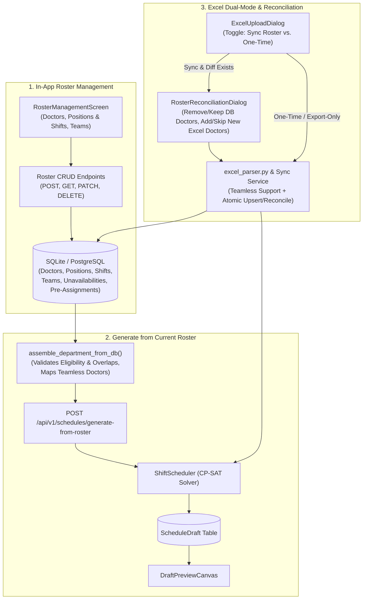

# Department Roster & Schedule Generation Guide

## 1. Overview

Schedule-Maker maintains a persistent per-department roster in the database (`Team`, `Position`, `Shift`, `Doctor`, `DoctorPosition`, `DoctorUnavailability`, and `DoctorPreAssignment`) and supports generating monthly duty schedules in two ways:

1. **Direct Generation from Current Department Roster**: Admins maintain their department roster directly in the Flutter app (**Manage Roster**) and generate monthly schedules via `POST /api/v1/schedules/generate-from-roster`.
2. **Excel Upload (Dual Mode)**:
   - **One-Time Export (`sync_roster=False`, default)**: Parses the `.xlsx` workbook, runs the solver, and saves an export-only draft (`status="one_time"`) without modifying the database roster.
   - **Roster Sync with Reconciliation (`sync_roster=True`)**: Compares the spreadsheet's doctors against the active database roster (`POST /api/v1/schedules/preview-excel-roster-diff`), prompts the admin in `RosterReconciliationDialog` to reconcile differences, updates the database roster atomically, and saves a publishable draft.

---

## 2. End-to-End Architecture

---

## 3. How Each Flow Works

### A. In-App Roster Management (CRUD)
- Opened from `AdminHeroCard` (**Manage Roster**) → [`RosterManagementScreen`](file:///C:/Users/ptria/source/repos/Schedule-Maker/frontend/lib/features/admin/presentation/screens/roster_management_screen.dart), which displays **Doctors**, **Positions & Shifts**, and **Teams** in horizontally scrollable carousels backed by [`RosterManagementController`](file:///C:/Users/ptria/source/repos/Schedule-Maker/frontend/lib/features/admin/presentation/controllers/roster_management_controller.dart).
- **Teams**: Create, rename (`PATCH`), and soft-delete (`DELETE`). Deleting a team atomically unassigns `team_id = None` on its doctors without deleting the doctors.
- **Positions & Shifts**: Create, edit, and soft-delete positions (`duty_days` `0..6` Mon–Sun; `showRosterPositionDialog` strips any legacy out-of-range day indices on edit) and nested shifts (`doctors_per_shift`, `grants_day_off`). Deleting a position or shift cascades soft-deletes to child shifts, doctor eligibility links, and upcoming pre-assignments (`date >= today`) while leaving historical published `ShiftAssignment` rows intact.
- **Doctors, Eligibility & Monthly Dates**: Create and edit doctors (without requiring `User` accounts), assign a team or `"No Team"`, toggle eligible `Positions` (`DoctorPosition`), and add/remove unavailability dates and shift pre-assignments in the **Schedule Dates** dialog (including multi-day calendar selection).
- **Restore-in-Place**: Re-creating a previously soft-deleted `Team`, `Position`, `Shift`, `DoctorPosition`, `DoctorUnavailability`, or `DoctorPreAssignment` restores the existing row (`is_deleted = False`, `sync_status = False`) rather than hitting a SQL uniqueness conflict.

### B. Generating from Current Department Roster
1. Selecting **Generate Schedule → Current Department Roster** calls `POST /api/v1/schedules/generate-from-roster`.
2. [`assemble_department_from_db`](file:///C:/Users/ptria/source/repos/Schedule-Maker/backend/src/schedule/roster_assembler.py) queries all active entities for the department and target month (`YYYY-MM`) in batch repository calls, builds `src.models.Department`, validates coverage/overlaps, and feeds it to `ShiftScheduler` via `_solve_and_persist_draft` in [`service.py`](file:///C:/Users/ptria/source/repos/Schedule-Maker/backend/src/schedule/service.py).
3. The resulting `ScheduleDraft` is persisted and rendered on [`DraftPreviewCanvas`](file:///C:/Users/ptria/source/repos/Schedule-Maker/frontend/lib/features/admin/presentation/widgets/draft_preview_canvas.dart).

### C. Generating & Reconciling from Excel
1. **One-Time (`sync_roster=False`)**: Runs the solver directly from the spreadsheet and saves the draft with `status="one_time"`. `publish_schedule_draft` rejects `"one_time"` drafts with HTTP 400, repository list/month queries exclude them, and **Publish Schedule** is disabled on the canvas (export-only).
2. **Sync Roster (`sync_roster=True`)**:
   - The frontend calls `POST /api/v1/schedules/preview-excel-roster-diff`.
   - If the database already has a roster and doctors differ, `RosterReconciliationDialog` lets the admin choose **Keep** *(default)* or **Remove** for DB doctors missing from Excel, and **Add** *(default)* or **Skip** for new Excel doctors.
   - `POST /api/v1/schedules/generate-from-excel` applies those choices, upserts matching entities, and saves the solved `ScheduleDraft` in a single atomic transaction.

---

## 4. Core Business Rules & Invariants

1. **Doctor vs. User Separation & Doctor Removal**:
   - Administrators manage `Doctor` records independently of `User` accounts; unlinked doctors default to `email = ""` in solver models and `ScheduleDraft.assignments`.
   - Removing a doctor soft-deletes only the `Doctor` row (`is_deleted = True`) and active `DoctorPosition` links, leaving any linked `User` row active so the user can join another department (unaffiliated user routing tracked in [BL-020](file:///C:/Users/ptria/source/repos/Schedule-Maker/backend/docs/backlog.md#L446-L470)).
2. **Position Eligibility & Validation**:
   - Every active `Position` must have at least one shift and at least one eligible doctor (`DoctorPosition`). Otherwise generation fails fast with HTTP 400 before running the solver.
   - A doctor cannot hold both an unavailability and a shift pre-assignment on the same date (blocked on write with HTTP 422 and checked during roster assembly).
3. **Teamless Doctors (`team_id = None`)**:
   - Both DB assembly and Excel parsing place teamless doctors into `Department.teamless_doctors` so they participate in shift and fairness constraints without being grouped into a synthetic team's same-day post-shift rest constraint.
4. **Standardized `duty_days` (`0..6`)**:
   - `Position.duty_days` uses Python's `datetime.date.weekday()` (`0 = Monday` … `6 = Sunday`) across schemas, Excel parsing, Flutter UI, and the CP-SAT solver.
5. **Tenant & Role Boundaries**:
   - Roster endpoints enforce `DEPARTMENT_ADMIN` scoped to `current_user.department_id`, and `PATCH` schemas forbid `department_id` / `position_id` moves (`extra="forbid"`). Super Admin cross-department roster scope is tracked in [BL-022](file:///C:/Users/ptria/source/repos/Schedule-Maker/backend/docs/backlog.md#L494-L518).
6. **ACID Transactions**:
   - Multi-step writes (cascading soft-deletes, Excel roster sync/reconciliation, and schedule publishing) stage changes via `flush()` (`commit=False`) and execute one atomic `session.commit()`.

---

## 5. Main Source Locations

- **Backend Roster CRUD**: [`team/`](file:///C:/Users/ptria/source/repos/Schedule-Maker/backend/src/team/), [`position/`](file:///C:/Users/ptria/source/repos/Schedule-Maker/backend/src/position/), [`shift/`](file:///C:/Users/ptria/source/repos/Schedule-Maker/backend/src/shift/), [`doctor/`](file:///C:/Users/ptria/source/repos/Schedule-Maker/backend/src/doctor/)
- **Backend Assembly, Excel Sync & Generation**: [`roster_assembler.py`](file:///C:/Users/ptria/source/repos/Schedule-Maker/backend/src/schedule/roster_assembler.py), [`excel_parser.py`](file:///C:/Users/ptria/source/repos/Schedule-Maker/backend/src/schedule/excel_parser.py), [`service.py`](file:///C:/Users/ptria/source/repos/Schedule-Maker/backend/src/schedule/service.py), [`routes.py`](file:///C:/Users/ptria/source/repos/Schedule-Maker/backend/src/schedule/routes.py)
- **Frontend Roster Data & UI**: [`roster_remote_data_source.dart`](file:///C:/Users/ptria/source/repos/Schedule-Maker/frontend/lib/features/admin/data/datasources/roster_remote_data_source.dart), [`roster_repository.dart`](file:///C:/Users/ptria/source/repos/Schedule-Maker/frontend/lib/features/admin/data/repositories/roster_repository.dart), [`roster_management_controller.dart`](file:///C:/Users/ptria/source/repos/Schedule-Maker/frontend/lib/features/admin/presentation/controllers/roster_management_controller.dart), [`roster_management_screen.dart`](file:///C:/Users/ptria/source/repos/Schedule-Maker/frontend/lib/features/admin/presentation/screens/roster_management_screen.dart), [`roster_dialogs.dart`](file:///C:/Users/ptria/source/repos/Schedule-Maker/frontend/lib/features/admin/presentation/widgets/roster_dialogs.dart)
- **Follow-up Backlog**: [backlog.md](file:///C:/Users/ptria/source/repos/Schedule-Maker/backend/docs/backlog.md) (`BL-020`–`BL-023`)
