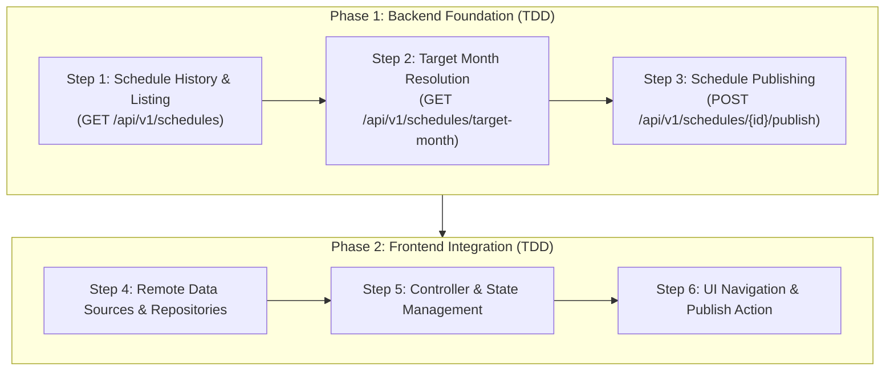

# Schedule Publishing & Target Month Navigation Plan

## Overview & Architecture

This plan establishes the end-to-end mechanism to:
1. Dynamically resolve the **Target Month** for schedule generation as **the next month after the last published schedule** (with fallback to `DateTime.now() + 1 month` if none exist).
2. Enable administrators to **Publish** schedule drafts, officially locking them and advancing the target month.
3. Allow administrators to **browse previous schedules and drafts** using interactive month navigation controls in the Flutter admin dashboard.

The architecture enforces the **Backend Readiness Gate**: all backend database queries, business rules, and API endpoints are built and verified with TDD before connecting the Flutter frontend.

---



---

## Progress & Status

| Step | Scope | Description | Status |
| :--- | :--- | :--- | :--- |
| **Step 1** | Backend | Schedule History & Listing Query (`GET /api/v1/schedules`) | `[x] Completed` |
| **Step 2** | Backend | Dynamic Target Month Resolution (`GET /api/v1/schedules/target-month`) | `[x] Completed` |
| **Step 3** | Backend | Schedule Publishing (`POST /api/v1/schedules/{id}/publish`) | `[x] Completed` |
| **Step 4** | Frontend | Remote Data Sources & Repositories | `[ ] Up Next` |
| **Step 5** | Frontend | State Management & Controller Updates | `[ ] Pending` |
| **Step 6** | Frontend | UI Month Navigation & Publish Action | `[ ] Pending` |

---

## Step 1: Backend — Schedule History & Listing Query `[x] Completed`

### 1. Problem Statement
Currently, the backend only provides `GET /api/v1/schedules/draft?target_month=...` which fetches a single draft for one specific month. There is no query or endpoint to retrieve historical drafts or published schedules for a department. Without this, the frontend cannot present a list of past months or indicate whether a given month has an existing draft or published schedule.

### 2. Technical Implementation
- **Repository** ([`backend/src/schedule/repository.py`](file:///C:/Users/ptria/source/repos/Schedule-Maker/backend/src/schedule/repository.py)):
  - Implement `list_schedules_for_department(session: Session, department_id: uuid.UUID) -> list[ScheduleDraft]`:
    Queries non-deleted drafts for the department, ordered by `target_month DESC, created_at DESC`.
- **Schemas** ([`backend/src/schedule/schemas.py`](file:///C:/Users/ptria/source/repos/Schedule-Maker/backend/src/schedule/schemas.py)):
  - Add `ScheduleSummaryRead` Pydantic model:
    ```python
    class ScheduleSummaryRead(BaseModel):
        id: uuid.UUID
        target_month: str
        status: str  # "draft" | "published"
        total_duties: int
        solver_status: str
        source_filename: str
        created_at: datetime.datetime
        updated_at: datetime.datetime
    ```
- **Controller & Route** ([`backend/src/schedule/routes.py`](file:///C:/Users/ptria/source/repos/Schedule-Maker/backend/src/schedule/routes.py)):
  - Add `GET /api/v1/schedules`:
    - Enforces department membership via `require_department_member`.
    - Returns `list[ScheduleSummaryRead]`.
- **TDD Tests**:
  - Add test cases in [`backend/src/schedule/tests/test_routes.py`](file:///C:/Users/ptria/source/repos/Schedule-Maker/backend/src/schedule/tests/test_routes.py) and [`backend/src/schedule/tests/test_service.py`](file:///C:/Users/ptria/source/repos/Schedule-Maker/backend/src/schedule/tests/test_service.py) covering empty history, populated history, soft-deleted exclusions, and multi-tenant isolation (Department A cannot see Department B's schedules).

### 3. Completion Definition
- `GET /api/v1/schedules?department_id=...` returns HTTP 200 with an array of schedule summaries ordered chronologically descending.
- Accessing another department's schedules returns HTTP 403 Forbidden.
- All new and existing unit tests pass.

---

## Step 2: Backend — Dynamic Target Month Resolution from `ShiftAssignment` `[x] Completed`

### 1. Problem Statement
The application currently hardcodes `'2026-11'` in multiple places. Since **`ShiftAssignment` is the ultimate operational source of truth**, the target month must be calculated based on existing published assignments: **the month immediately following the latest active shift assignment in the department**. If no shift assignments exist yet for the department, it must fall back to **the next calendar month from today's date**. Handling this centrally on the backend guarantees consistent calendar arithmetic and year rollovers (e.g. December $\to$ January).

### 2. Technical Implementation
- **Repository** ([`backend/src/shift/repository.py`](file:///C:/Users/ptria/source/repos/Schedule-Maker/backend/src/shift/repository.py)):
  - Implement `get_latest_shift_assignment_date_for_department(session: Session, department_id: uuid.UUID) -> Optional[datetime.date]`:
    Queries `MAX(ShiftAssignment.date)` joined through `Shift` and `Position` where `Position.department_id == department_id` and records are not soft-deleted.
- **Service** ([`backend/src/schedule/service.py`](file:///C:/Users/ptria/source/repos/Schedule-Maker/backend/src/schedule/service.py)):
  - Implement `resolve_next_target_month(session: Session, department_id: uuid.UUID) -> dict[str, Optional[str]]`:
    - Looks up `get_latest_shift_assignment_date_for_department`.
    - If found (e.g. `2026-10-31`), extracts the month (`"2026-10"`) and computes the subsequent month (`"2026-11"`, handling year rollover from December to January).
    - If none exists, calculates the next month relative to `datetime.date.today()`.
    - Returns `{"next_target_month": "YYYY-MM", "last_published_month": "YYYY-MM" | None}`.
- **Schemas & Route** ([`backend/src/schedule/routes.py`](file:///C:/Users/ptria/source/repos/Schedule-Maker/backend/src/schedule/routes.py)):
  - Add schema `TargetMonthResponse`:
    ```python
    class TargetMonthResponse(BaseModel):
        next_target_month: str
        last_published_month: Optional[str] = None
    ```
  - Add route `GET /api/v1/schedules/target-month` requiring department membership.
- **TDD Tests**:
  - Add tests covering:
    1. Fresh department with no shift assignments (resolves to next calendar month from today).
    2. Department with shift assignments in same year (`2026-05-31` $\to$ `2026-06`).
    3. Year rollover edge case (`2026-12-31` $\to$ `2027-01`).
    4. Soft-deleted shift assignments are excluded.

### 3. Completion Definition
- `GET /api/v1/schedules/target-month?department_id=...` returns HTTP 200 with `next_target_month` calculated from `ShiftAssignment` records.
- Year rollover and soft-delete exclusion unit tests pass with 100% accuracy.

---

## Step 3: Backend — Schedule Publishing (Materializing `ShiftAssignment` Rows) `[x] Completed`

### 1. Problem Statement
Generated schedules currently remain in `status="draft"` permanently. There is no API operation to officially approve and commit a draft into real **`ShiftAssignment`** rows. Without committing to `ShiftAssignment`, staff doctors cannot see their shifts on individual mobile calendars, and the target month cannot advance.

### 2. Technical Implementation
- **Repository Support**:
  - In [`src/shift/repository.py`](file:///C:/Users/ptria/source/repos/Schedule-Maker/backend/src/shift/repository.py):
    - `soft_delete_shift_assignments_for_department_month(session, department_id, year, month)`: Atomically soft-deletes prior assignments to ensure idempotency per [`BL-015`](file:///C:/Users/ptria/source/repos/Schedule-Maker/backend/docs/backlog.md#L332-L352).
    - `bulk_create_shift_assignments(session, assignments)`: Batch-inserts new `ShiftAssignment` records.
  - In [`src/schedule/repository.py`](file:///C:/Users/ptria/source/repos/Schedule-Maker/backend/src/schedule/repository.py):
    - `update_schedule_draft_status(session, draft_id, status)`: Sets `status = "published"`.
- **Publishing Service** ([`backend/src/schedule/service.py`](file:///C:/Users/ptria/source/repos/Schedule-Maker/backend/src/schedule/service.py)):
  - Implement `publish_schedule_draft(session: Session, draft_id: uuid.UUID, department_id: uuid.UUID, current_user: UserModel) -> ScheduleDraft`:
    - Validates caller has department admin authorization.
    - Validates draft exists, is active, and belongs to the department.
    - If draft is already `"published"`, raises `ValueError("Schedule is already published")`.
    - **Entity Auto-Provisioning**: Matches each assignment's doctor email, position name, and shift name to database IDs. If any doctor, position, or shift does not yet exist in the relational tables, auto-provisions them for this department. *(Logged and tracked via [`BL-017`](file:///C:/Users/ptria/source/repos/Schedule-Maker/backend/docs/backlog.md#L379-L396))*.
    - **Atomic Commit Transaction**:
      1. Soft-deletes existing assignments for that department & month (`BL-015`).
      2. Inserts all `ShiftAssignment(doctor_id=..., shift_id=..., date=...)` records.
      3. Updates `ScheduleDraft.status = "published"`.
      4. Commits transaction.
- **Route** ([`backend/src/schedule/routes.py`](file:///C:/Users/ptria/source/repos/Schedule-Maker/backend/src/schedule/routes.py)):
  - Add `POST /api/v1/schedules/{draft_id}/publish`:
    - Enforces `require_department_admin`.
    - Returns HTTP 200 with updated `ScheduleDraftRead`.
- **TDD Tests**:
  - Add test cases in [`backend/src/schedule/tests/test_routes.py`](file:///C:/Users/ptria/source/repos/Schedule-Maker/backend/src/schedule/tests/test_routes.py) for:
    1. Successfully publishing a draft and verifying `ShiftAssignment` records are created in DB.
    2. Idempotent re-publishing: verifying old assignments for the month are soft-deleted (`BL-015`).
    3. Auto-provisioning of missing doctors and shifts.
    4. 404 for non-existent draft ID and 403 for unauthorized department.
    5. 400 for publishing an already published schedule.

### 3. Completion Definition
- `POST /api/v1/schedules/{draft_id}/publish` commits the draft into `ShiftAssignment` records and sets status to `"published"`.
- Immediately following publication, calling `GET /api/v1/schedules/target-month` advances to the next month.
- All backend tests pass with 100% green coverage.

---

## Step 4: Frontend — Data Layer & Remote Data Sources

### 1. Problem Statement
The Flutter frontend data source ([`schedule_draft_remote_data_source.dart`](file:///C:/Users/ptria/source/repos/Schedule-Maker/frontend/lib/features/admin/data/datasources/schedule_draft_remote_data_source.dart)) and repository ([`schedule_draft_repository.dart`](file:///C:/Users/ptria/source/repos/Schedule-Maker/frontend/lib/features/admin/data/repositories/schedule_draft_repository.dart)) only contain methods for `generateFromExcel`, `fetchActiveDraft`, and `exportDraft`. They lack the client contracts to fetch target month info, fetch schedule history, or trigger publish.

### 2. Technical Implementation
- **DTOs & Domain Models**:
  - Create `ScheduleSummaryDto` and `ScheduleSummary` model ([`frontend/lib/features/admin/domain/models/schedule_summary.dart`](file:///C:/Users/ptria/source/repos/Schedule-Maker/frontend/lib/features/admin/domain/models/schedule_summary.dart)).
  - Create `TargetMonthInfoDto` and `TargetMonthInfo` model ([`frontend/lib/features/admin/domain/models/target_month_info.dart`](file:///C:/Users/ptria/source/repos/Schedule-Maker/frontend/lib/features/admin/domain/models/target_month_info.dart)).
- **Remote Data Source** ([`schedule_draft_remote_data_source.dart`](file:///C:/Users/ptria/source/repos/Schedule-Maker/frontend/lib/features/admin/data/datasources/schedule_draft_remote_data_source.dart)):
  - Add `Future<TargetMonthInfoDto> fetchTargetMonthInfo({String? departmentId})` calling `GET /api/v1/schedules/target-month`.
  - Add `Future<List<ScheduleSummaryDto>> fetchScheduleHistory({String? departmentId})` calling `GET /api/v1/schedules`.
  - Add `Future<ScheduleDraftDto> publishScheduleDraft({required String draftId})` calling `POST /api/v1/schedules/$draftId/publish`.
- **Repository Interface & Implementation**:
  - Expose the corresponding methods returning domain entities (`TargetMonthInfo`, `List<ScheduleSummary>`, `ScheduleDraft`).
- **Unit Tests**:
  - Add unit tests in [`frontend/test/features/admin/data/`](file:///C:/Users/ptria/source/repos/Schedule-Maker/frontend/test/features/admin/data/) mocking HTTP responses and verifying serialization and error handling.

### 3. Completion Definition
- Frontend repository methods successfully serialize/deserialize responses from backend Step 1, 2, and 3 endpoints.
- Unit tests verify all network calls, query parameters, and error responses.

---

## Step 5: Frontend — State Management & Controller Updates

### 1. Problem Statement
The presentation controller ([`schedule_generation_controller.dart`](file:///C:/Users/ptria/source/repos/Schedule-Maker/frontend/lib/features/admin/presentation/controllers/schedule_generation_controller.dart)) has `'2026-11'` hardcoded as a default parameter and does not maintain the active selected month, schedule history list, or publishing state in its `ScheduleGenerationState`.

### 2. Technical Implementation
- **State Model** (`ScheduleGenerationState`):
  - Add `selectedMonth: String` (current active month viewed on canvas).
  - Add `targetMonthInfo: TargetMonthInfo?` (metadata about next target & last published).
  - Add `scheduleHistory: List<ScheduleSummary>` (list of available drafts and schedules).
  - Add `isPublishing: bool` (loading indicator for publish action).
- **Controller Methods**:
  - `initializeDashboard({String? departmentId})`:
    1. Fetches `targetMonthInfo` and `scheduleHistory`.
    2. Sets `selectedMonth = targetMonthInfo.nextTargetMonth`.
    3. Loads the draft for `selectedMonth` if one exists.
  - `selectMonth(String targetMonth, {String? departmentId})`:
    Switches `selectedMonth` and fetches the draft/published schedule for that month.
  - `publishCurrentDraft()`:
    Publishes the active draft, updates its status to `"published"`, and reloads `targetMonthInfo` and `scheduleHistory`.
- **Unit Tests**:
  - Add tests in [`frontend/test/features/admin/presentation/`](file:///C:/Users/ptria/source/repos/Schedule-Maker/frontend/test/features/admin/presentation/) verifying state transitions: initialization, month switching, and publishing.

### 3. Completion Definition
- `ScheduleGenerationController` initializes dynamically based on server state without any hardcoded month string.
- Controller unit tests pass with 100% green status.

---

## Step 6: Frontend — UI Month Navigation & Publish Action

### 1. Problem Statement
[`AdminHeroCard`](file:///C:/Users/ptria/source/repos/Schedule-Maker/frontend/lib/features/admin/presentation/widgets/admin_hero_card.dart) statically displays the text `'November'`, with no ability to switch months. [`DraftPreviewCanvas`](file:///C:/Users/ptria/source/repos/Schedule-Maker/frontend/lib/features/admin/presentation/widgets/draft_preview_canvas.dart) has an "Export to Excel" button, but no "Publish Schedule" button.

### 2. Technical Implementation
- **Month Navigation in `AdminHeroCard`**:
  - Replace static month title with an interactive selector:
    - Previous and Next chevron buttons (`<` and `>`).
    - Month title (e.g. `"November 2026"`).
    - Status badge reflecting the current schedule state:
      - 🟢 `Published` (read-only; schedule is official).
      - 🟡 `Draft` (tentative; can be edited, regenerated, exported, or published).
      - ⚪ `Ready to Generate` (no schedule exists for this month yet).
    - Quick-jump history menu (dropdown or bottom sheet) showing past months with status chips.
- **Publish Action in `DraftPreviewCanvas`**:
  - When viewing a draft (`status == "draft"`):
    - Display a **"Publish Schedule"** button (`FilledButton.icon` with check icon) alongside "Export to Excel".
    - Clicking displays a confirmation dialog explaining that publishing finalizes the roster.
    - On confirm, calls `publishCurrentDraft()`.
- **Locked State for Published Schedules**:
  - When viewing an already published schedule (`status == "published"`):
    - Hide the "Generate" button or disable roster overwrite.
    - Keep "Export to Excel" enabled.
- **Widget Tests**:
  - Add widget tests verifying that chevron navigation triggers month changes, status badges update, and the publish button appears only on draft status.

### 3. Completion Definition
- The administrator can navigate between months, view previous drafts and published schedules, generate a schedule for the automatically calculated target month, and publish the final draft.
- All Flutter widget tests and analyzer checks (`flutter test`, `flutter analyze`) pass with 0 warnings.
