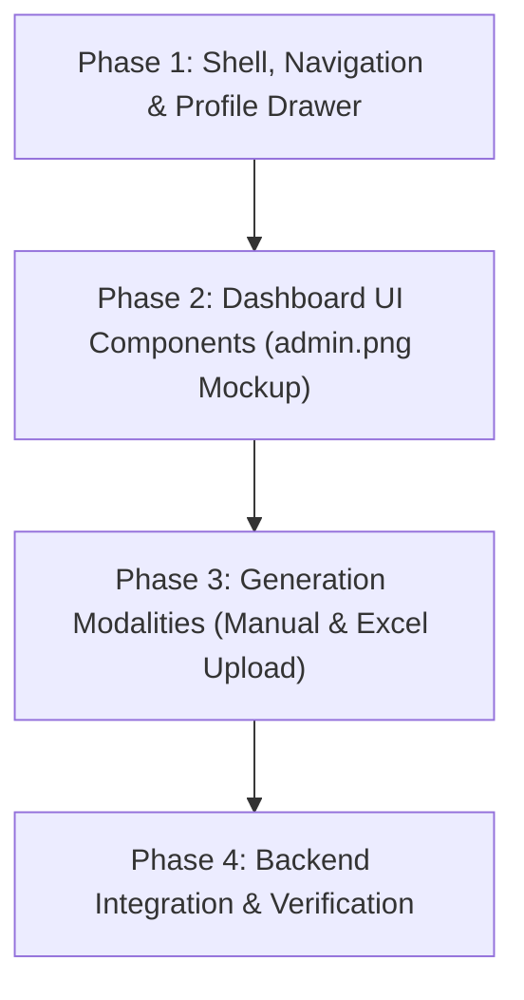

# Implementation Plan: Admin Screen & Schedule Generation

This document outlines the end-to-end implementation plan for the **MedShift Admin Screen & Dashboard** (`features/admin`), derived from the clinical design mockup ([`admin.png`](file:///C:/Users/ptria/Downloads/admin.png)) and operational requirements.

---

## 1. Feature Overview & Requirements

The Admin Screen serves as the operational command center for Department Administrators and Hospital Staff Managers. It enables administrators to monitor department readiness, manage rosters and unavailabilities, generate duty schedules, and review draft assignments before publication.

### Key Requirements (from Mockup & Specification)

1. **Bottom Navigation Bar**:
   - Persistent Material 3 navigation bar with 4 destinations:
     - **Dashboard** (`Icons.grid_view_outlined` / `Icons.grid_view`)
     - **Schedule** (`Icons.calendar_month_outlined` / `Icons.calendar_month`)
     - **Requests** (`Icons.swap_horiz_outlined` / `Icons.swap_horiz`)
     - **Admin** (`Icons.admin_panel_settings_outlined` / `Icons.admin_panel_settings`) - *active tab highlighted in pill*.
2. **Top Header & User Profile Drawer**:
   - Header with "MedShift Admin" branding.
   - Notification bell action button (`Icons.notifications_none`).
   - Circular profile avatar (`CircleAvatar`) representing the authenticated admin.
   - Tapping the avatar opens a Navigation Drawer / Sidebar displaying the administrator's **full name** (sourced from `currentUserProvider`) and account details.
3. **Month Hero & Schedule Generation Banner**:
   - Displays target scheduling period (e.g. "November 2023").
   - Status badge indicator: "● Ready to Generate".
   - Explanatory copy: *"Algorithm is primed with all staff requests, leave approvals, and coverage requirements. Estimated processing time: ~45 seconds."*
   - Prominent action button: **"✨ Generate Schedule"**.
4. **Dual Schedule Generation Modalities**:
   - **Mode A: In-App Manual Management**: Admin adds doctors, shifts, positions, and unavailabilities directly within the app, then triggers generation.
   - **Mode B: Excel File Upload**: Admin uploads an `.xlsx` workbook containing doctor rosters and unavailabilities, which the solver engine parses to generate the schedule.
5. **Metric Summary Cards**:
   - **Leave Requests Card**: Total requests processed (e.g. "42", "100% Processed") with a linear progress bar.
   - **Unavailabilities per Doctor Card**: Count requiring attention (e.g. "3", "Requires Attention" in warning red) with critical department chips (e.g. `ICU - Nov 12`, `ER - Nov 15`).
   - **Staff Pool Card**: Total active and available roster count (e.g. "118", "Includes 12 rotating residents").
6. **Draft Preview Canvas**:
   - Interactive container with view mode toggles (calendar, list, grid).
   - Empty state: Circular calendar icon with title *"Awaiting Generation"* and subtitle *"The draft schedule will appear here. You can review, manually adjust conflicts, and finalize before publishing to staff."*
   - Active state: Renders draft assignments upon solver completion.

---

## 2. Architecture & MVVM Structure

```
frontend/lib/features/admin/
├── domain/
│   └── models/
│       ├── admin_dashboard_metrics.dart   # Metric counts, leave % and warning chips
│       └── schedule_generation_mode.dart  # Manual vs Excel upload enum
├── data/
│   ├── dtos/
│   │   └── admin_metrics_dto.dart
│   ├── datasources/
│   │   └── admin_remote_data_source.dart  # Generates schedule, uploads Excel, fetches metrics
│   └── repositories/
│       └── admin_repository.dart
└── presentation/
    ├── controllers/
    │   ├── admin_navigation_controller.dart # Active bottom nav index & drawer state
    │   └── schedule_generation_controller.dart # Solver execution & draft state
    ├── screens/
    │   ├── admin_screen.dart              # Main composite screen matching admin.png
    │   └── admin_shell.dart               # Shell with AppBar, Drawer, and BottomNavigationBar
    └── widgets/
        ├── admin_profile_drawer.dart      # Sidebar displaying admin fullName & profile
        ├── admin_hero_card.dart           # Hero banner with Month & Generate button
        ├── admin_metric_cards.dart        # 3 metric summary cards (Leave, Unavailability, Staff)
        ├── draft_preview_canvas.dart      # Awaiting generation canvas & draft view
        ├── excel_upload_dialog.dart       # Drag-and-drop / file picker for .xlsx
        └── admin_bottom_nav_bar.dart      # 4-destination navigation bar
```

---

## 3. Phased Implementation Plan (TDD Workflow)



### Phase 1: App Shell, Navigation & Profile Drawer
**Goal**: Build the outer scaffold containing the persistent Bottom Navigation Bar and Top AppBar with the circular profile avatar opening the sidebar drawer.

- **Step 1.1: `ProfileDrawer` Widget (Shared)**:
  - Displays the logged-in user's profile header using `currentUserProvider`.
  - Shows `user.fullName`, `user.email`, and `user.role.displayName`.
  - Provides a Logout button wired to `AuthController.logout()`.
  - Reusable across all user roles (doctors, head nurses, admins).
  - **Location**: `lib/shared/widgets/profile_drawer.dart`
  - **TDD Test**: `test/shared/widgets/profile_drawer_test.dart` (asserts full name rendering from Riverpod state).
- **Step 1.2: `BottomNavBar` Widget (Shared)**:
  - Material 3 `NavigationBar` with standard destinations: Dashboard, Schedule, Requests, and conditionally Admin if `showAdminTab` is true.
  - Highlights active tab.
  - Tapping an item triggers `onTabSelected(int index)`.
  - Reusable across all user roles.
  - **Location**: `lib/shared/widgets/bottom_nav_bar.dart`
  - **TDD Test**: `test/shared/widgets/bottom_nav_bar_test.dart`.
- **Step 1.3: `AdminScreen` Scaffold**:
  - Combines `AppBar` (leading/trailing avatar & notification bell), `Drawer` (`ProfileDrawer`), body content, and `bottomNavigationBar` (`BottomNavBar`).
  - Tapping the avatar calls `Scaffold.of(context).openDrawer()`.
  - **Location**: `lib/features/admin/presentation/screens/admin_screen.dart`
  - **TDD Test**: `test/features/admin/presentation/screens/admin_screen_test.dart` (asserts drawer opens on avatar tap and displays `fullName`).

---

### Phase 2: Dashboard Presentation Components (`admin.png` Fidelity)
**Goal**: Implement the exact visual cards and layout matching the MedShift clinical admin mockup.

- **Step 2.1: `AdminHeroCard` (Month Header & Generate Trigger)**:
  - Header: Target month & year (e.g. "November 2023") with month picker / selector.
  - Status pill: "● Ready to Generate" with green accent dot.
  - Subtitle: *"Algorithm is primed with all staff requests, leave approvals, and coverage requirements. Estimated processing time: ~45 seconds."*
  - Primary button: "✨ Generate Schedule" with sparkle icon.
  - **TDD Test**: `test/features/admin/presentation/widgets/admin_hero_card_test.dart`.
- **Step 2.2: `AdminMetricCards` (4-Card Pre-Flight System)**:
  - Card 1: **Schedule Due Date**: Target publish date (`Oct 25`), countdown badge (`5 Days Left`), submission status (`Requests Closed`).
  - Card 2: **Pending Approvals**: Pending time-off count (`2`), action pill (`Action Required` or `All Clear`).
  - Card 3: **Staff Pool & Capacity**: Active doctor count (`18 Doctors`), total shifts to assign (`90 Shifts to Assign`), workload ratio (`~5.0 shifts/doctor`).
  - Card 4: **Coverage Bottlenecks**: High-demand dates count (`3 Tight Days`), warning badge (`Requires Attention`), date chips (`ICU - Nov 12`, `ER - Nov 15`).
  - Responsive layout: 4-column row on wide desktop (> 1100px), 2x2 grid on tablet/medium, vertical column on mobile.
  - **TDD Test**: `test/features/admin/presentation/widgets/admin_metric_cards_test.dart`.
- **Step 2.3: `DraftPreviewCanvas`**:
  - Container with rounded borders and elevation matching mockup.
  - Header with title "Draft Preview Canvas" and view toggle actions (grid, list).
  - Empty state: Circular gray calendar icon, "Awaiting Generation" heading, explanatory text.
  - Active state: Previews generated draft schedule table/grid.
  - **TDD Test**: `test/features/admin/presentation/widgets/draft_preview_canvas_test.dart`.

---

### Phase 3: Schedule Generation Modalities & State Management
**Goal**: Connect generation triggers to both Manual configuration and Excel spreadsheet upload flows.

- **Step 3.1: Generation Mode Selection Dialog**: `[x] Completed`
  - Created `GenerationModeDialog` prompting admin to choose between Current Department Roster or Excel upload.
  - **TDD Test**: `test/features/admin/presentation/widgets/generation_mode_dialog_test.dart` (passing).
- **Step 3.2: `ExcelUploadDialog` (Spreadsheet Import Flow)**: `[x] Completed`
  - Integrated `file_picker: ^13.1.0`.
  - Created `ExcelUploadDialog` with drag/browse area, file details, clear action, and generate action.
  - **TDD Test**: `test/features/admin/presentation/widgets/excel_upload_dialog_test.dart` (passing).
- **Step 3.3: `ScheduleGenerationController` (Riverpod ViewModel)**: `[x] Completed`
  - Riverpod `Notifier<ScheduleGenerationState>` managing solver lifecycle (`idle`, `solving`, `success`, `error`).
  - Connects to `AdminHeroCard` (disables button & displays loading spinner while solving) and `DraftPreviewCanvas` (reveals draft on success).
  - **TDD Test**: `test/features/admin/presentation/controllers/schedule_generation_controller_test.dart` (passing).
- **Step 3.4: Manual Roster & Operational Setup Flow (Deferred to Backlog `BL-003`)**:
  - The backend solver (`scheduler.py`) requires doctors, positions, shifts, unavailabilities, and pre-assignments to generate a schedule manually. Deferred to `docs/backlog.md` (`BL-003`) while immediate priority is Excel-based schedule generation.

---

### Phase 4: Excel-Based Solver Route & Live Full-Stack Integration
**Goal**: Define the complete Excel workbook contract, build the backend solver upload endpoint, and integrate the frontend to solve live `.xlsx` schedules.

#### 1. Excel Workbook Data Contract Specification
To generate a monthly schedule directly from an Excel file without requiring prior database setup, the uploaded `.xlsx` workbook must contain all relevant operational data:

- **Sheet 1: `Doctors` (Primary Required Sheet)**:
  - **Rows**: Each row represents an individual doctor.
  - **Columns**:
    1. `Name` (String): Full name of the doctor (e.g. `Dr. Gregory House`).
    2. `Email` (String): Unique identifier and contact email (e.g. `house@hospital.org`).
    3. `Position` (String): Clinical position or specialty (e.g. `ER`, `ICU`, `Attending`, `Resident`).
    4. `Team` (Optional String): Team designation (e.g. `Team Alpha`) to balance duties across teams.
    5. `Unavailability` (String): Comma-separated day numbers of the target month (e.g. `3, 14, 22`) or ISO dates (`2026-11-03, 2026-11-14`) when the doctor cannot work.
    6. `Pre-Assignments` (String): Fixed, locked-in assignments before solving, in the format `Day:Shift` or `Date:Shift` (e.g. `5:Morning, 12:Night`).
    7. `Max Duties` (Optional Integer): Monthly duty cap override for this doctor (defaulting to department standard, e.g. 7 or 8 duties).

- **Sheet 2: `Positions & Shifts` (Optional Configuration Sheet)**:
  - Defines coverage rules and shift types if custom rules are needed beyond defaults:
    1. `Position` (String): Clinical position matching the doctors sheet (e.g. `ER`).
    2. `Shift Name` (String): Name of the shift (e.g. `Morning`, `Night`, `24h Duty`).
    3. `Doctors Per Shift` (Integer): Required staffing per shift (default `1`).
    4. `Duty Days` (String): Operational days of the week (e.g. `0,1,2,3,4,5,6` or `Mon-Sun`).
    5. `Grants Day Off` (Boolean/String): Whether working this shift enforces the next day off (`Yes`/`No` or `TRUE`/`FALSE`).
  - *If omitted, the solver applies standard department positions and 1 doctor per calendar day.*

#### 2. Backend Implementation (`backend/src/`):
- Create route: `POST /api/v1/schedules/generate-from-excel` in FastAPI accepting `UploadFile` (.xlsx).
- Parser utility reading sheets, validating mandatory columns, and parsing unavailabilities/pre-assignments.
- Integration with `backend/src/scheduler.py` CP-SAT solver.
- Returns JSON schedule response containing solver metrics and array of `ShiftAssignment` objects:
  ```json
  {
    "status": "OPTIMAL",
    "target_month": "2026-11",
    "total_duties": 30,
    "assignments": [
      {
        "date": "2026-11-01",
        "doctor_name": "Dr. Gregory House",
        "position": "ER",
        "shift": "Night"
      }
    ]
  }
  ```
- Pytest unit and integration tests verifying valid workbook parsing, missing column validation, and solver output.

#### 3. Frontend Live Integration (`frontend/lib/features/admin/`):
- Create `ScheduleRemoteDataSource` using `Dio` `FormData` to upload `PlatformFile` to `POST /api/v1/schedules/generate-from-excel`.
- Wire `ScheduleRepository` in `schedule_generation_controller.dart` to dispatch to the remote data source.
- Update `DraftPreviewCanvas` to render the returned assignments in an interactive calendar/table view.
- Verify end-to-end flow from file selection -> upload -> CP-SAT solve -> draft visualization.

---

## 4. Acceptance Criteria

1. **Top Bar**: Profile avatar in circle is visible; tapping opens sidebar drawer displaying `user.fullName`.
2. **Bottom Nav**: 4 tabs (Dashboard, Schedule, Requests, Admin) render cleanly with active state indicator.
3. **Hero & Metrics**: Exactly replicates visual hierarchy of `admin.png` (hero banner with month & generate button, 3 metric cards with progress bar and warning tags).
4. **Canvas**: Displays "Awaiting Generation" placeholder when idle; switches to draft preview on generation.
5. **Generation Options**: Supports both in-app roster generation and Excel spreadsheet upload.
6. **Code Quality**: Built test-first (TDD), zero static analysis issues, Riverpod state management, responsive on Windows Desktop and Mobile.
